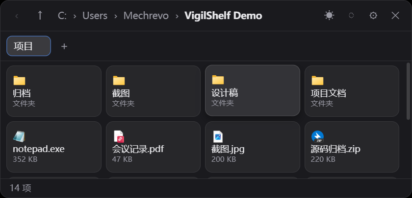
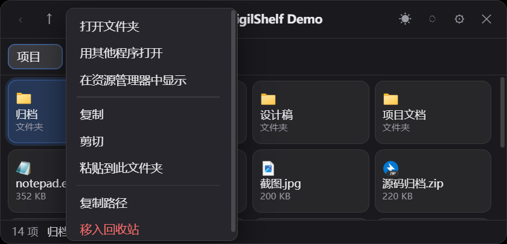
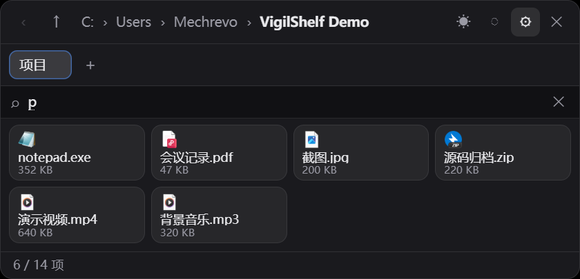
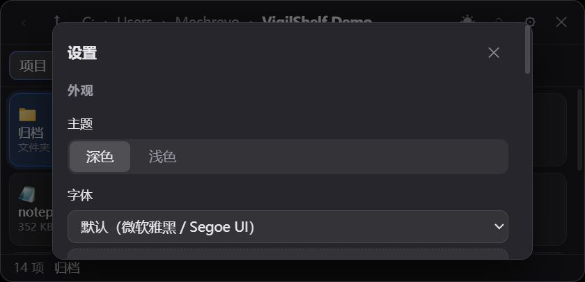

# VigilShelf

**鼠标推到屏幕最顶端，一块文件面板就滑出来。**

把常用目录挂进去，文件拖进来、拖出去，鼠标一移开它自己收起。
不打开资源管理器，不在两个窗口之间来回切，也不用把桌面堆满。

`Windows 10 / 11` · `Tauri 2 + Rust + React` · 安装包约 1.6 MB · 不需要管理员权限



---

## 它解决什么问题

日常最高频的文件操作是「把 A 目录的文件挪到 B 目录」。在 Windows 上这要开两个资源管理器窗口、
来回切，拖拽时目标窗口还常常被挡在前面。VigilShelf 把这件事压成三步：

1. 鼠标推到屏幕最顶端 → 面板从顶边滑出
2. 把文件拖到目标位置 → 松手
3. 鼠标移开 → 面板自动消失在边缘

面板**不进任务栏、不抢焦点、永远置顶**，像一块随手能抽出来的抽屉。

位置上它是固定的：永远贴在**鼠标所在那块显示器**的顶边居中，并且**不能被拖动**。
位置一旦能变，下次用热区呼出来时就会在不同地方跳出来，反而更像故障。

## 藏在屏幕顶边

| 呼出方式 | 说明 |
| --- | --- |
| 屏幕顶部热区 | 鼠标碰到屏幕上边缘并停留 `hotzone_delay_ms`（默认 150ms）后滑出 |
| 全局快捷键 | 默认 `Ctrl+Alt+Space`，同样在顶边居中弹出（多显示器下跟随鼠标所在屏） |
| 系统托盘 | 左键点击图标呼出 / 收起；右键菜单只有「显示 / 收起面板」和「退出 VigilShelf」 |

鼠标移开 `hide_delay_ms`（默认 300ms）后自动收起。但面板内右键菜单、设置、添加对话框打开期间
**不会收起**（鼠标经常要移到面板外面去点），拖拽进行中也会挂住。

热区只认 1 像素高的触发带，所以不会在正常点窗口标题栏时误触。全屏程序盖住顶边时热区失效，
这时用全局快捷键。

## 像资源管理器一样的交互

### 浏览

- 面包屑逐级点回、`←` 后退、`↑` 上一级、`F5` 刷新；路径太深时左侧自动渐隐
- 卡片网格：**4 列 × 2 行，一屏 8 个**，卡片显示类型图标 + 文件名 + 大小（文件夹写「文件夹」）
- 鼠标停在卡片上显示完整路径、大小与修改时间

### 图标取自 Windows 外壳

快捷方式、可执行文件、各类文档显示的都是**它们真正的图标** —— 和资源管理器同一套取图路径
（`IShellItemImageFactory::GetImage`），不是内置的通用图形。外壳取不到时静默回落到内置 SVG。

### 文件操作



- 多选：单击选中、`Ctrl` 加选、`Shift` 范围选
- `Ctrl+C` / `Ctrl+V` 复制粘贴，`Ctrl+X` / `Ctrl+V` 剪切移动；剪贴板走资源管理器格式，
  **能和资源管理器互相粘贴**
- 同名文件自动改名（`name (2).ext`），不会静默覆盖
- **拖出**：按住面板里的文件拖到资源管理器 / 微信 / QQ / 任何接受文件拖放的窗口上，走 Rust 侧原生
  OLE 拖拽（`IDropSource`），跨进程交付的是真实文件路径
- **拖入**：从资源管理器把文件拖到面板里的某个文件夹卡片上，直接放进去
- 右键菜单：打开文件夹、用其他程序打开、在资源管理器中显示、复制、剪切、粘贴到此文件夹、
  复制路径、移入回收站

## 文件随手可得

### 工作空间

每个工作空间 = 一个名称 + 一个根目录，在顶部显示为标签页。右键标签可重命名 / 关闭，`+` 新建。
添加时可以从内置的快速位置（桌面、下载、文档、图片、视频…）里挑，也可以直接输入路径、
在对话框里逐级点进子目录。

### Ctrl+F 找文件



面板顶部出现筛选条，按文件名做不区分大小写的子串匹配，不符合的卡片立刻消失，
状态栏显示 `命中数 / 总数`。筛选不写进设置 —— 面板每次重新弹出、或者切换目录，筛选都会自动清掉，
避免下次打开时以为文件丢了。

## 外观



- **主题**：深色 / 浅色两套，顶栏有快捷切换按钮
- **字体**：从系统已装字体里枚举，列表用每种字体自身渲染，挑的时候能直接看出差别
- **字号**：11–16 px 滑杆。行高、顶栏、标签栏、状态栏、列宽、图标尺寸都由它推导，改一个数整块界面一起缩放
- **背景图**：选一张本地图片（内置图片浏览器，带缩略图预览），配三个滑杆：
  - 模糊 0–40 px：糊掉照片细节，文件名可读性明显更好
  - 暗化 / 提亮 0–100%：在背景图上盖一层黑（浅色主题盖白），字看不清时调大它
  - 面板不透明度 20–100%：面板整体浓淡，调低能透出桌面和背景图
- **动效**：面板每次弹出都从顶部滑入 + 缩放渐显，卡片逐张错开渐入，收起时原路缩回；
  悬停、主题切换都有过渡；系统开了「减少动态效果」时全部自动关掉

设置写在 `%APPDATA%\com.mechrevo.vigilshelf\`。滑杆拖动即时预览，点「保存」才写盘，
点「取消」恢复原样。文件损坏或字段缺失都会回落默认值，越界数值（如字号 999）在加载时会被夹回
合法区间，不会导致程序起不来。

---

## 快捷键

| 按键 | 作用 |
| --- | --- |
| `Esc` | 逐层关闭：右键菜单 → 确认框 → 添加对话框 → 设置 → 筛选条 → 收起面板 |
| `Ctrl+F` | 打开筛选条（再按 `Esc` 关闭并清空） |
| `Backspace` | 上一级目录 |
| `F5` | 刷新当前目录 |
| `Ctrl+C` / `Ctrl+X` / `Ctrl+V` | 复制 / 剪切 / 粘贴到当前目录 |
| `Ctrl+Alt+Space` | 全局快捷键：呼出 / 收起面板（可在设置里改） |

---

## 安装

1. 下载 `VigilShelf_*_x64-setup.exe` 并安装
2. 首次启动没有窗口，**只出现在托盘**（右下角，可能要点开折叠区）
3. 鼠标推到屏幕上边缘，或者按 `Ctrl+Alt+Space`

要开机自启的话，把 exe 的快捷方式丢进
`%APPDATA%\Microsoft\Windows\Start Menu\Programs\Startup`。

绿色版：直接运行 `vigilshelf.exe` 即可，不需要安装。

### 从旧版本（ReachFile）升级

本项目曾叫 ReachFile，配置目录名从 `%APPDATA%\com.mechrevo.reachfile\` 换成了
`%APPDATA%\com.mechrevo.vigilshelf\`。首次启动新版时会自动把旧目录里的两个文件复制过来
（**只读旧目录，不删源文件**）；如果新目录里已经有配置文件，则跳过迁移，不会覆盖你已经改过的设置。

---

## 与 macOS 版 FinderHub 的差异

本项目参照 [FinderHub](https://www.finderhub.app/) 的功能做的 Windows 版，受系统能力所限有几处等价替换：

| FinderHub（macOS） | VigilShelf（Windows） |
| --- | --- |
| 挂在刘海下面 | 挂在屏幕顶边，鼠标悬停呼出 |
| `⌘ + option + →` 在光标旁呼出 | 全局快捷键在顶边居中呼出（面板位置固定，不可拖动） |
| 空格键 Quick Look 预览 | 未实现 |
| `Control + 点击` AirDrop | 移除（Windows 无对应能力） |
| 移到废纸篓 | 移入回收站 |
| `⌘ + 点击` 在 Finder 中显示 | 在资源管理器中显示 |

---

## 技术栈

| 层 | 选型 |
| --- | --- |
| 外壳 | Tauri 2（Rust 后端 + WebView2 前端） |
| 前端 | React 19 + TypeScript + Vite |
| 剪贴板 | `clipboard-win`（资源管理器 CF_HDROP 格式，双向兼容） |
| 拖出 | `drag`（原生 `IDropSource`） |
| 图标 | `file_icon_provider`（Windows 外壳，PRGBA → PNG → data URL） |
| 背景图 | Tauri `protocol-asset` 的 `convertFileSrc`，白名单只开图片扩展名 |
| 回收站 | `trash` |
| 打包 | NSIS 安装器 / 绿色版 exe |

体积和内存占用都远低于 Electron 方案，且不需要管理员权限。

---

## 开发

```bash
pnpm install

# 开发模式（热更新）
pnpm tauri dev

# 前端检查
pnpm exec tsc --noEmit
pnpm build

# 后端四项（改 Rust 后必须全绿）
cd src-tauri
cargo fmt --check
cargo check --all-targets
cargo clippy --all-targets
cargo test

# 打安装包
pnpm tauri build --bundles nsis
```

> **发布必须走 `pnpm tauri build`。** 直接 `cargo build --release` 产出的是 **dev 构建**：
> 它不内嵌 `dist/`，而是去连 `build.devUrl`（`http://localhost:1420`）。如果那一刻正好有别的项目
> 在 1420 上跑 Vite，面板会渲染出**别人的界面**，看起来像代码被污染了。
> `run()` 里对 dev 构建有一条启动告警，看到它就别拿去发版。

### 项目结构

| 路径 | 内容 |
| --- | --- |
| `src-tauri/src/hotzone.rs` | 顶边热区轮询线程（60ms）与自动收起状态机 |
| `src-tauri/src/window_ctl.rs` | 位置与尺寸常量（`PANEL_WIDTH`/`PANEL_HEIGHT`）、进出场事件 |
| `src-tauri/src/fs_ops.rs` | 列目录、复制、移动、回收站、剪贴板、打开方式 |
| `src-tauri/src/icons.rs` | 向 Windows 外壳取图标并编码成 PNG data URL |
| `src-tauri/src/fonts.rs` | 枚举系统字体族（PowerShell 读注册表） |
| `src-tauri/src/store.rs` | 设置 / 工作空间读写、旧配置目录迁移 |
| `src/lib/appearance.ts` | **外观唯一入口**：把设置写进 `:root` 的 CSS 变量 |
| `src/components/FileList.tsx` | 卡片网格 |
| `docs/PLAN.md` | 分阶段实现记录与取舍 |
| `docs/demo/` | README 截图用的演示目录（纯占位文件） |
| `docs/screenshots/` | README 用的截图 |

### 调试提示

- 面板默认以 `visible: false` 启动，只留托盘图标。开发时用托盘左键或快捷键呼出。
- 窗口是 `transparent + decorations: false`，前端 `html/body` 必须保持 `background: transparent`，
  圆角由 `.app` 的 CSS 提供；改背景色只改 `.app` 的 `background` 和 `:root` 里的变量，别动 `body`。
- 外观全部由 `src/lib/appearance.ts` 写进 `:root` 的 CSS 变量
  （`--fs` / `--card-gap` / `--bg-image` …）。
  **别在组件里单独算尺寸**：字号一变，行高、顶栏、列宽都得跟着变，分散写必然对不齐。
- **颜色只能出现在 `:root` 与 `[data-theme="light"]` 两块里**，组件样式一律写 `var(...)`。
  踩过的坑：浮层底色曾经写死成 `#232329` / `#26262c`，切到浅色主题后文字跟着变成深色 `#1c1c1e`，
  深底深字 —— 看起来像「主题没生效」，实际是底色漏改了。
- 背景图遮罩的颜色也是主题变量（`--dim-rgb`）：深色主题盖黑、浅色主题盖白。浅色主题另有 55% 的
  地板值（`appearance.ts` 的 `LIGHT_DIM_FLOOR`），否则把「提亮」拉到 0 时会得到一片读不出来的黑字。
- `applyAppearance()` 跑在 `useEffect` 里，**任何字段缺失都会让整个 App 白屏**，而 React 只报
  「An error occurred in the App component」，完全看不出是字段问题。所以取值一律写 `?? 默认值`；
  另外用陈旧的 Rust 二进制配新前端也会撞上（旧的 `Settings` 结构没有新字段）。
- 背景图必须放在 `.backdrop` 这一独立层里 —— `filter: blur()` 作用于整个元素，
  写在 `.app` 上会把上面的文件名一起模糊掉。
- 卡片网格的列数是**写死的 4 列**，行高反过来由容器高度除出来
  （`grid-auto-rows: calc((100% - var(--card-gap)) / 2)`）：两行加行距正好等于容器高度，
  第 3 行因此永远落在可视区之外。改成写死的行高，字号一大就会在卡底挂一条被切开的边。
- `--icon-size` 的倍率（1.35）不能跟着字号线性放大：行高几乎不随字号变，而文字和图标会，
  倍率取大了、字号调到 16 时内容会被卡片裁掉（`.card` 的 `overflow: hidden` 只是兜底）。
- 卡片渐入用 `--card-index` 驱动延迟，`animation-fill-mode` 是 `backwards` 而非 `both`：
  用 `both` 会让动画终态永久压住 `:hover` 的 `transform`，鼠标悬停就没反馈了。
- 改字号区间要**同时**改两处：`src-tauri/src/model.rs` 的 `MIN_FONT_SIZE` / `MAX_FONT_SIZE` /
  `MAX_BG_BLUR` 和 `src/types.ts` 里同名的常量，否则滑杆能拖到后端会被夹回的区间。
- 热区线程每 60ms 轮询一次光标位置（`hotzone.rs`）。改这个间隔会直接影响 CPU 占用。
- 全局拖放事件是 `getCurrentWebview().onDragDropEvent()`，其 payload 类型在不同 Tauri 2 小版本间
  有差异，`App.tsx` 里对此有一处带 `SAFETY` 注释的断言。
- 文件图标每次通过命令 `shell_icons` 向 Windows 外壳要。它**按扩展名缓存**，但 `.exe` / `.lnk` /
  无扩展名不缓存。看着图标不对时先确认路径存在、不是网络盘 —— 外壳取不到是**静默**回落 SVG 的。
- 面板的进出场动画靠 React 换 `key` 重建 `.app` 来重放（`App.tsx` 的 `runId`）。
  删掉那个 `key`，动画就只在第一次启动时可见。
- 退场相关时长有硬约束：`App.css` 的 `panel-out`（150ms）与 `App.tsx` 的定时器（170ms）
  必须**小于** Rust 侧 `window_ctl::HIDE_FALLBACK_DELAY`（600ms），否则兜底会抢在前端隐藏之前触发，
  退场动画就永远只放到一半。
- 想验证进退场动画真的在放（而不是硬切）：把光标停在屏幕最上沿 900ms 唤出面板，再移到屏幕中央，
  然后按约 60ms 间隔连拍全屏图，统计**面板矩形区域的平均亮度**。硬切只会得到「面板在位」和
  「面板消失」两个值；能拍到介于两者之间的中间值，才说明动画确实跑了。
  两个坑：① 热区需要光标在顶边停留满 150ms 才触发，连拍脚本若 120ms 就移开会一张都拍不到面板；
  ② 直接看单张截图分不出「动画中」和「没面板」—— 必须拿亮度值跟上下的帧对比。

### 重新生成 README 截图

截图里不能出现真实文件名，也不能出现仓库目录名，所以先准备两样东西：

1. `docs/demo/`（仓库内，13 个占位文件）拷一份到 `%USERPROFILE%\VigilShelf Demo`，再从
   `C:\Windows\System32\notepad.exe` 拷一个过去 —— 演示目录里得有一个真可执行文件，
   才能拍出「exe 显示自己的图标」；但系统二进制不进仓库（已在 `.gitignore` 里）。
   面包屑显示的是**真实路径**，直接拍 `docs/demo` 会把仓库目录名一起拍进去
2. 把工作空间指向那个副本，并把 `settings.json` 临时改成「无背景图、默认字体」的干净外观
   （否则你自己的壁纸和字体就会进公开 README）

然后跑 `scripts/shots.ps1`：它会唤出面板，先后点开右键菜单 / 设置 / `Ctrl+F`，抓四张图。
它用 `PrintWindow(hwnd, hdc, 2)`（让窗口画自己）截图，**完全不受 z 序影响**，
所以桌面上开着什么都不会漏进图里。三个必须知道的约束：

- **不要把面板窗口挪到别处再截。** Chromium 对「被遮住的 WebView2」有遮挡检测，一旦判定被遮住
  就停止产帧，`PrintWindow` 于是画出一片纯黑。面板必须在自己的顶边锚点位置、在最上层。
- `Ctrl+F` 后**只发一个按键**。中文输入法会在两个音节开头之间插入撇号（`m` + `p` 变成 `m'p`），
  截图里的筛选词就废了。
- 右键菜单那张会先 `Ctrl+C` 复制一个文件：剪贴板为空时「粘贴到此文件夹」是灰的，
  截图里看着像功能坏了。

脚本里的坐标是面板相对坐标（面板物理尺寸固定 840×405，即 560×270 逻辑像素 @150%），
`绝对坐标 = 面板左上角 + 相对坐标`。拍完把 `settings.json` 与 `workspaces.json` 还原回去。

---

## 数据位置

| 内容 | 路径 |
| --- | --- |
| 设置 | `%APPDATA%\com.mechrevo.vigilshelf\settings.json` |
| 工作空间 | `%APPDATA%\com.mechrevo.vigilshelf\workspaces.json` |

两个文件都是纯 JSON，删掉即恢复默认。

---

## 已知边界

- 仅 Windows（依赖 Win32 剪贴板格式与 OLE 拖放），不做跨平台。
- 目录不显示体积（递归求和会让大目录卡住列表），卡片上只写「文件夹」三个字。
- 卡片只放得下一行小字，**修改时间不在卡片上**，鼠标停在卡片上看悬停提示。
- 文件名按像素截断（CSS 省略号），长文件名的扩展名可能被截掉；文件类型由图标表达。
- 固定 4 列。卡片里放得下的文字有限，想少截断只能把面板加宽。
- 删除走回收站，不提供「永久删除」，也没有 `Delete` 快捷键（走右键菜单）。
- 没有 `Ctrl+A` 全选。
- 拖拽到「以管理员身份运行」的程序上时，Windows 的 UIPI 机制会拦截，这是系统限制。
- 切换主题有约 200ms 的颜色过渡，不做「无动画秒切」选项。
- 背景图只支持常见位图格式，且路径会被写进设置文件；移动或删除该图片后面板会回到纯色底，不会报错。
- 面板不支持拖动，也不支持调整大小（尺寸是代码常量 `window_ctl::PANEL_WIDTH` / `PANEL_HEIGHT`，
  不再来自设置）。字号在 11–16 之间改动时，可见卡片数保持不变（始终 4 列 × 2 行）。

---

## 许可证

[MIT](LICENSE) © 2026 cmacckk

第三方依赖的许可证：`tauri` / `serde` / `chrono` / `uuid` / `png` / `base64` / `dirs` 为 MIT OR
Apache-2.0，`react` / `react-dom` / `vite` / `file_icon_provider` / `trash` 为 MIT，`clipboard-win`
为 BSL-1.0，`typescript` 为 Apache-2.0 —— **无 GPL/AGPL**，不构成传染。
